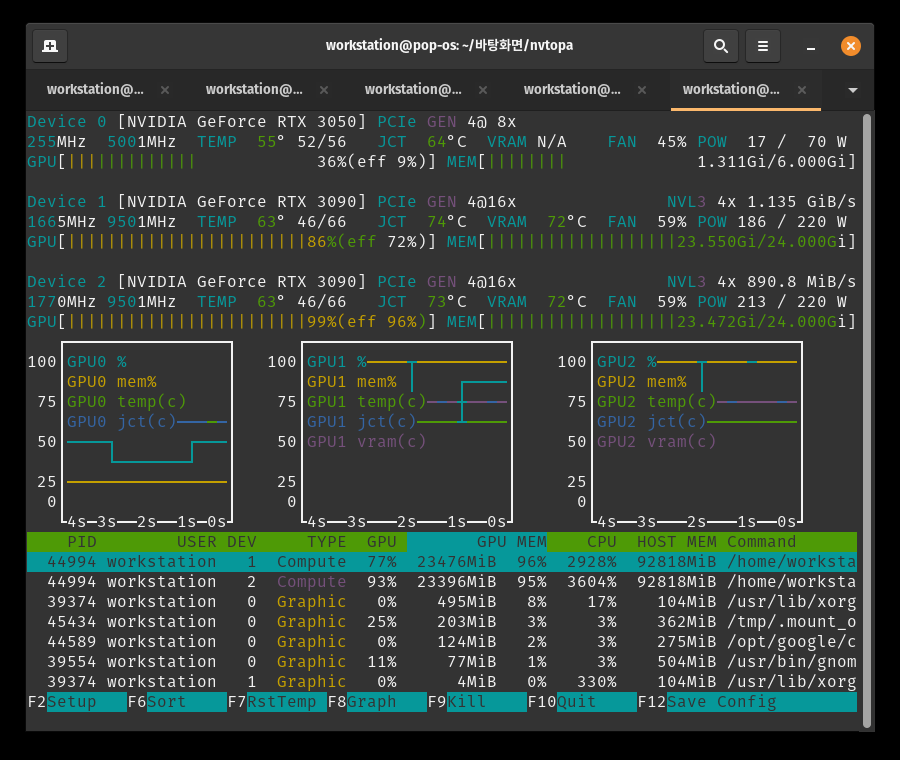
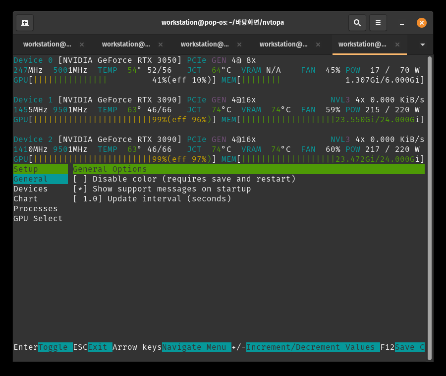

# nvtopa

English | [한국어](README.ko.markdown) | [中文](README.zh.markdown) | [日本語](README.ja.markdown)

A fork of [syllo/nvtop](https://github.com/syllo/nvtop) focused on **temperature
instrumentation** and a **device header that never gets cut off**, no matter how
narrow the terminal is.



---

## Table of Contents

- [What this fork adds](#what-this-fork-adds)
- [Keyboard shortcuts](#keyboard-shortcuts)
- [Screenshots](#screenshots)
- [Test environment](#test-environment)
- [Build and install](#build-and-install)
- [Documentation](#documentation)
- [License](#license)

## What this fork adds

### 1. Width-adaptive device header

Upstream nvtop lays the device header out at a fixed width of roughly 120
columns, so on a typical terminal the power, fan and clock fields simply run
off the right edge. This fork fits the header to the console before the layout
is computed, by walking a fixed **give-up ladder**: the fan padding, the clock
labels, the ECC and NVLink fields and finally the min/max readouts are dropped
one after another until the row fits. The core temperature is never dropped
entirely.

```
Device 1 [NVIDIA GeForce RTX 3090] PCIe GEN 4@16x   NVL3 4x 0.000 KiB/s
1455MHz 9501MHz  TEMP  63° 46/66   JCT  74°C   VRAM  74°C   FAN  59%  POW 215 / 220 W
```

Verified by a pty sweep that nothing is cut off anywhere between **40 and 200
columns**.

### 2. Session min/max temperatures, with a reset key

`TEMP`, `JCT` and `VRAM` each show the current reading plus the minimum and
maximum seen since the program started (or since the last reset):

- `TEMP 63° 46/66` — now 63 °C, minimum 46 °C, maximum 66 °C
- Press **F7** to reset the history; the min/max values collapse to the
  current reading and re-track from there.

The min/max values survive a terminal resize, because they live with the
device state rather than with the terminal windows.

### 3. NVLink throughput beside the PCIe one

The NVLink transfer rate moved from the end of the second header line, where it
was the first thing a narrow terminal cut off, to **line 1, right after the
PCIe throughput**:

```
Device 1 [NVIDIA GeForce RTX 3090] PCIe GEN 4@16x   NVL3 4x 0.000 KiB/s
```

The PCIe field is right-sized to the shape it actually draws — the verbose
`PCIe GEN 4@16x RX: ... TX: ...` (46 columns), an abbreviated
`GEN 4@16x RX 9.2G/TX 10.1G` (30), or just `PCIe GEN 4@16x` (14) — so the NVLink
field sits snugly after it instead of after a run of blanks. When the room is
gone entirely, below roughly 60 columns, NVLink is dropped and PCIe gets the
space back. A board without a bridge keeps a blank slot, exactly as it did
before.

### 4. The original power format at every width

Upstream degrades `POW x / y W` (draw / max) to a bare `POW x W` on narrow
terminals; this fork keeps the original draw-and-max format everywhere and
drops the field only when there is nothing left to give.

### 5. Up to ten plot lines per GPU

The per-GPU chart accepts up to 10 metrics at once (upstream allows 4). The
default draws **all of them in one chart per device**, each in its own color:

- GPU utilization rate
- GPU memory utilization rate
- GPU core temperature
- memory junction temperature
- memory (VRAM) temperature

A line for a sensor the board does not report is skipped automatically — an
RTX 3050 has no memory-temperature sensor, so it draws no `vram(c)` line.

### 6. F8 — cycle the graph contents

One chart per device shows different metrics depending on the mode; **F8**
cycles through them and empties the plot buffers so the modes never mix:

| mode | lines drawn |
| --- | --- |
| all metrics (default) | utilization, mem utilization and every reported temperature |
| original nvtop | GPU utilization and memory utilization only |
| temperatures only | core, junction and memory temperature only |

### 7. Memory junction and VRAM temperatures from GDDR registers

The fork's original feature, inherited from
[ThomasBaruzier/gddr6-core-junction-vram-temps](https://github.com/ThomasBaruzier/gddr6-core-junction-vram-temps):
`JCT` (memory junction, also called hot spot) and `VRAM` (the memory devices)
are read from registers of the GDDR6/GDDR6X/GDDR7 memory controller that no
supported API reports. Ampere (RTX 30) and later boards only; anything older is
left alone. An ordinary user can read them after a udev rule hands the first
BAR of the GPUs to a group — see the [machine-setup
repository](https://github.com/xzrka/nvtopa-setup) for the script that does it.

## Keyboard shortcuts

| key | action |
| --- | --- |
| `F2` | interactive setup window (Chart page configures plot lines and their colors) |
| `F6` | sort the process list |
| `F7` | **reset the temperature history** (min/max) |
| `F8` | **cycle the graph contents** (all metrics → original nvtop → temperatures only) |
| `F9` | kill a process |
| `F10` | quit |
| `F12` | save preferences |
| `Ctrl+L` | force a full repaint |

## Screenshots

Main view on three NVIDIA GPUs — width-adaptive header with min/max
temperatures, NVLink beside PCIe, and a five-line chart per device:


The setup window (`F2`), from where the Chart page turns individual plot lines
on and off and cycles their colors:



## Test environment

The fork is developed and verified on this machine:

| item | value |
| --- | --- |
| GPUs | 1 × NVIDIA GeForce RTX 3050 (GDDR6, no memory-temperature sensor), 2 × NVIDIA GeForce RTX 3090 (GDDR6X, NVLink-paired as NVL3 4x) |
| OS | Pop!_OS (Ubuntu-based), Linux x86-64 |
| driver | NVIDIA proprietary driver (NVML + BAR0 register access) |
| terminal | GNOME Terminal; headless verification through a pty harness |

Verification:

- **`tests/temp_colors.py`** — replays the program in a pty and extracts the
  SGR color in effect over every `TEMP` / `JCT` / `VRAM` digit, so the color
  coding of the temperature fields is checked automatically. Run with
  `python3 tests/temp_colors.py 80 24 -- ./build/src/nvtop`.
- **`tests/pty_capture.py`** — runs the program in a pty of any size and
  prints the screen; used to sweep the header from 40 to 200 columns and to
  verify the give-up ladder at each width.
- **`ctest`** — the upstream test suite plus `nvidia_vram_temps`, which stands
  the sensor registers up in a fake sysfs and checks the decoded readings.
- **`tests/interfaceTests.cpp`** — unit tests of the PCIe bandwidth table.
- A manual pty sweep at **40, 50, 60, 70, 80, 90, 100, 120, 160 and 200
  columns** confirms nothing is cut off and the power field keeps its
  `POW x / y W` format everywhere; the three F8 graph modes and the F7 reset
  were exercised both in the pty and live in GNOME Terminal.

## Build and install

Standard nvtop build:

```bash
git clone https://github.com/xzrka/nvtopa.git
cd nvtopa
mkdir build && cd build
cmake .. -DCMAKE_BUILD_TYPE=Release
make -j$(nproc)
```

On the machine this fork is developed on, `install-nvtopa.sh` from the
[machine-setup repository](https://github.com/xzrka/nvtopa-setup) builds the
fork and installs it as `nvtopa`, next to the distribution's `nvtop`, and
`unprivileged-temps.sh` sets up the udev rule that lets an ordinary user read
the memory-temperature registers.

## Documentation

- [`docs/UPSTREAM_README.markdown`](docs/UPSTREAM_README.markdown) — the full
  upstream documentation: vendor support, per-distribution installation,
  troubleshooting.
- Upstream project: <https://github.com/syllo/nvtop>
- Machine setup (udev rule, installer, fake sysfs): <https://github.com/xzrka/nvtopa-setup>

## License

Same as upstream nvtop: BSD-3-Clause.
